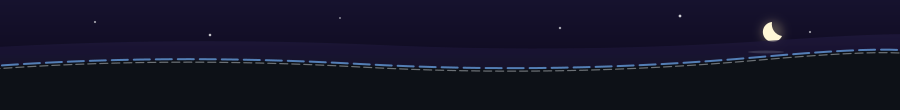

  <!-- Handcrafted Custom Animated Sunset Beach Banner -->
  

  <!-- Animated Typing Text (Sunset Shoreline Vibes) -->
  

---

### 🌴 About Me

Hello! I am **Vin**, a dedicated student with a strong passion for technology and an aspiration to become a professional **Web Developer**. I enjoy designing and building modern web applications, tackling complex programming challenges, and continuously learning new paradigms in software engineering.

- 🎓 **Status:** Student & Tech Enthusiast
- 🎯 **Career Goal:** Professional Web Developer & Software Engineer
- ⚡ **Core Languages:** PHP, JavaScript, Python
- 🚀 **Frameworks & Libraries:** Laravel, React
- 🗄️ **Databases:** MySQL / SQL
- 🌱 **Current Learning Focus:** Full-Stack Web Development, RESTful APIs, & Clean Architecture
- 💬 **Open for Discussion:** PHP/Laravel, JavaScript/React, Modern UI Slicing, & Python Scripting

---

### 🛠️ Tech Stack & Tools

  <h4>Languages & Frameworks</h4>
  

    

  <h4>Tools & Platforms</h4>
  

---

### 🎮 Interactive Arenas

  <h4>♟️ Real-Time Chess Arena</h4>
  
Challenge an AI Bot or a friend in an interactive real-time chess match directly in your browser.

  
    
  

    

  <h4>🎲 Digital Monopoly Board Game Arena</h4>
  
Classic 40-tile Monopoly featuring tactile physical aesthetics, official rules, transparent auctions, & smart AI.

  
    
  

---

### 🌊 Contribution Ocean Wave

  <picture>
    <source media="(prefers-color-scheme: dark)" srcset="https://raw.githubusercontent.com/itsvin-debug/itsvin-debug/output/github-contribution-grid-snake-dark.svg">
    <source media="(prefers-color-scheme: light)" srcset="https://raw.githubusercontent.com/itsvin-debug/itsvin-debug/output/github-contribution-grid-snake.svg">
    
  </picture>

---

### 📊 GitHub Statistics & Activity

  <!-- Streak Stats Card (Custom Sunset Beach Palette) -->
  

    

  <!-- Side-by-side Stats & Languages (Reflows naturally on mobile devices) -->
  

    
    &nbsp;&nbsp;
    
  

  <!-- 30-Day Activity Graph (Sunset Area Gradient) -->
  

    
  

---

### 📬 Connect With Me

  
  
  
  

 

  <!-- Handcrafted Custom Animated Night Beach Footer -->
  

